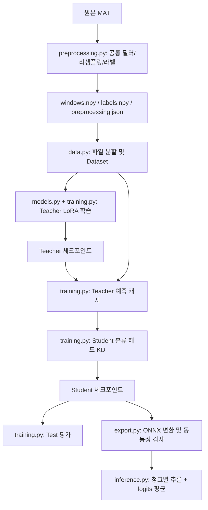

# 코드 흐름과 이전 코드 정리

## 학습 단위

Teacher는 청크별 정답을 이용한 cross entropy를 사용합니다. Student는 윈도우당 8개 청크 logits를 평균하고, 정답 cross entropy와 Teacher soft target KL divergence를 0.5씩 합칩니다. 온도는 2이고 KL에는 온도의 제곱을 곱합니다. 평가는 두 모델 모두 윈도우 단위입니다.

Teacher는 LoRA q/v와 head를 학습하고 Student는 head만 학습합니다. Teacher의 gradient checkpointing은 `use_reentrant=False`를 명시합니다. 원래의 reentrant 모드는 고정된 embedder 출력에 gradient가 없어 LoRA 기울기를 잃었습니다. 새 학습기는 모든 학습 대상의 유한한 gradient 존재를 검사합니다.

## 이전 파일 대응

| 이전 tests/ 파일 | 새 위치/처리 |
|---|---|
| 03_Process_Window.py, preprocess_kb.py, preprocess_ki.py | src/bearing_kd/preprocessing.py로 통합 |
| make_dataloader.py, resize.py, dataset.py, split.py | src/bearing_kd/data.py로 통합 |
| train_teacher_lora.py, train_student_kd.py | src/bearing_kd/models.py + training.py |
| save_teacher_prediction.py | training.py의 cache_teacher |
| check_kd_dataset.py, check_kd_alignment.py | DistillationDataset의 강제 무결성 검사 + 회귀 테스트 |
| evaluate_teacher.py, evaluate_teacher_kb.py, evaluate_student.py | evaluate-* 명령으로 통합 |
| export_student_onnx.py | export.py; 실제 수치 동등성 검사 추가 |
| test_student.py, test_momnets.py, demp.py | 실제 자동 테스트와 scripts/verify_pipeline.py로 대체 |
| analyzer.py | scripts/analysis/inspect_mat.py |
| fft.py, 02_Compare_bearing.py | scripts/analysis/compare_raw_signals.py로 통합 |
| compare_k_ka_kb.py | scripts/analysis/compare_waveforms.py |
| compare_spectrum_k_ka_kb.py | scripts/analysis/compare_spectra.py |
| inspect_kb_signal.py | scripts/analysis/inspect_kb_signal.py |
| extract_momnet_embedding.py | scripts/analysis/extract_embeddings.py |

분석 스크립트는 현재 로컬 `windows_1khz`와 정해진 베어링/측정조건을 사용하는 탐색 도구입니다. 핵심 파이프라인의 필수 단계는 아닙니다. 필요 시 파일 상단의 분석 대상 상수를 수정합니다.

## 보존 및 제외

- 정리 전 소스/README는 로컬 `outputs/legacy_source_before_cleanup/`에 보관했습니다. Git에서는 제외됩니다.
- 원본 데이터, 기존 split, 모델, 체크포인트, 기존 ONNX는 보존했습니다.
- 새 실험 출력은 명시적인 새 경로에 저장합니다. 기존 파일을 자동 덮어쓰지 않습니다.
- `.venv*`는 다른 로컬 작업에서도 사용할 수 있으므로 자동 삭제하지 않고 Git에서 제외했습니다.
- `hf_upload` 모델 복사본은 기존 배포용 파일일 수 있어 보존하되 Git에서는 제외합니다. `.onnx.data`는 반드시 유지해야 합니다.
- `.DS_Store`, 오래된 Python 캐시와 비어 있는 초기 폴더는 정리합니다.

## 알려진 평가 한계

기존 split은 파일 단위이며 베어링 개체가 train/validation/test에 반복됩니다. 99.60%를 새 베어링 일반화 성능으로 해석할 수 없습니다. 기존 체크포인트는 보존하지만, LoRA gradient 수정 후 제대로 학습한 Teacher/Student의 최종 성능은 전체 재학습으로 다시 측정해야 합니다.
